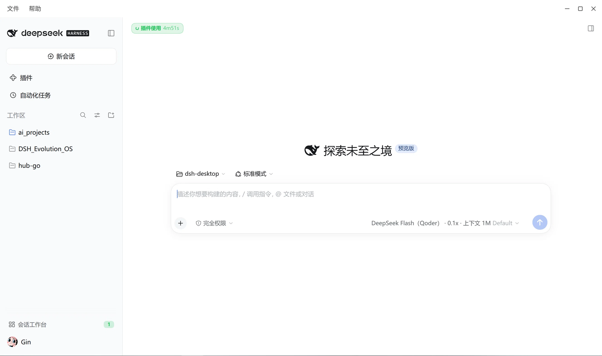

# dsh-shell-linux

Linux 桌面壳（Electron），把**你系统上已经装好的 DSH 的 Web 端**装进一个独立窗口——
就是你在浏览器里打开 `dsh web` 看到的那个界面，壳子只是给它一个自己的窗口。



*实际运行在 Ubuntu 26.04 / GNOME / Wayland：注入式标题栏（文件/帮助菜单 + 圆形窗口按钮）、会话侧栏、输入框。*

**它不是 DSH 的打包版，也不重新实现 DSH。** 壳子不打包任何 DSH 运行时，而是引用**你系统上已安装的那份**
DSH——自动探测 `~/.local/lib/node_modules/@deepseek-ai/dsh`（普通 `npm i -g` 更新的位置）和
`/usr/local/lib/node_modules/@deepseek-ai/dsh`，先命中哪个用哪个（可用 `DSH_INSTALL_ANCHOR` 指定），
用它自带的 Web 前端资源，并复用你现有的 `~/.dsh/profiles/web` profile（可用 `DSH_DESKTOP_PROFILE` 改）。
所以：**系统 `dsh` 一升级，壳子跟着升级**，不需要重新构建壳子。

## 它是怎么工作的

```
Electron 主进程（壳）
├── 加载 dsh-app://app/            ← 自定义协议，前端静态资源从系统 dsh 自带 dist 伺服
├── spawn host 子进程               ← 用系统 node 跑 runProfile('web')
│      └── 就绪后经 Node IPC 报回 URL（OS 随机端口，不占用 3080）
├── token → cookie 交换             ← 拿 host 的一次性 token 换浏览器会话 cookie
├── /api 请求经协议代理带 cookie 转发
└── WebSocket 握手由主进程改写头     ← origin / cookie / sec-fetch-site
```

三处关键设计（都是实测得出的，不是照抄）：

| 设计 | 原因 |
|---|---|
| host 用**系统 node** 跑，不用 Electron 的 node 模式 | Electron node 模式下 `process.versions.electron` 存在，`dsh-skill-office` 会抛 `packaged applications must supply a standalone Node executable`，导致 office 技能激活失败（实测 7 bundles 中 1 个不激活） |
| 必须由 preload 提供 `dshDesktopBoot` | 系统 dsh 的前端**没有"纯 web 模式"**：无 preload 时它要么永久挂在 `Loading plugins…`，要么抛 `bootstrap facade missing`。preload 是唯一能让 UI 渲染出来的路径 |
| WebSocket 由主进程改写握手头 | 渲染进程直连 `ws://127.0.0.1:<port>/api/remote.mux`，它发出的 `Origin: dsh-app://app` + `Sec-Fetch-Site: cross-site` 且没有 cookie，必被 host 的 `isTrustedApiRequest` / `browserAuth` 拒绝 |

## 安装与运行

前置：已安装 DSH（`~/.local/lib/node_modules/@deepseek-ai/dsh` 或 `/usr/local/lib/node_modules/@deepseek-ai/dsh`，自动探测），Node ≥ 22。

```sh
git clone https://github.com/liaiaaa/dsh-shell-linux.git
cd dsh-shell-linux
npm install
npm start
```

装好之后想让它在应用菜单里出现（推荐）：

```sh
scripts/install-desktop.sh
```

`npm start` = `npm run build && electron . --no-sandbox`。

> **关于 `--no-sandbox`**：不少发行版上 `node_modules/electron/dist/chrome-sandbox` 没有 SUID 位，
> 不加这个参数 Electron 会直接 `FATAL: The SUID sandbox helper binary was found, but is not
> configured correctly` 并以 SIGTRAP 退出。若你已执行
> `sudo chown root:root node_modules/electron/dist/chrome-sandbox && sudo chmod 4755 node_modules/electron/dist/chrome-sandbox`，
> 可以从 `package.json` 的 `start` 里去掉该参数。

其他命令：

```sh
npm test          # vitest 单测（纯逻辑，不需要 GUI；数量随功能增长，以实际输出为准）
npm run build     # tsc + esbuild 打 preload
scripts/install-desktop.sh            # 装菜单/桌面入口（换目录后必跑；--remove 卸载）
scripts/install-desktop.sh --check    # 自检菜单图标与入口是否和 assets 同步
node scripts/build-icons.mjs          # 从系统 dsh 前端的 favicon.svg 重新生成图标
node scripts/verify-shell.mjs <exprs.json>   # CDP 真机验证工具（断言 + 可选 --shot）
```

### 给 README 加截图

截图已放在 `docs/screenshot.png`（1600px 宽 PNG）。需要重截时：

`--shot` 依赖 CDP 的 `Page.captureScreenshot`，在 Wayland 下可能拿不到已合成的表面而超时。
**最可靠的办法是直接按打印屏幕键**：

- GNOME/Wayland：按 `PrtSc` 截全屏，或 `Shift+PrtSc` 选窗口，图片落到 `~/图片/截图/`
- 截好后覆盖 `docs/screenshot.png`（建议缩到 1600px 宽、保存为 PNG）

窗口内容是官方 dsh 前端，截屏时注意别把会话内容一起拍进去。

## 桌面功能

- **窗口状态记忆**：尺寸/位置/最大化状态存 `~/.config/dsh-shell-linux/window-state.json`，启动恢复（并夹紧到当前工作区，拔显示器后不会开到屏幕外）。
- **Ctrl+W 关窗**：`page.close` 在无可关面板时落到 `dshDesktop.keyboard.closeWindow` → 与标题栏关闭按钮同一条 IPC（实测走完整关闭阶梯，host 干净退出）。
- **标题栏双击最大化**：双击拖动条切换最大化（窗口按钮不响应双击序列）。
- **渲染进程崩溃自愈（未真机验证）**：`render-process-gone` 时自动重载页面，60 秒窗口内最多 2 次，超限走 fatal 错误窗；退避历史不会被重载成功击穿（单测覆盖）。SIGSEGV 探针无法观测该路径——renderer 被 SIGSEGV 后进入 crashpad 挂起态，CDP 完全冻结，真实 crash 行为留待实际使用验证。
- **快捷键偏好持久化**：设置 → 编辑快捷键 的修改经 `dshDesktop.shortcuts` 桥由主进程持久化到 `~/.config/dsh-shell-linux/keybindings.json`。协调器直接用系统 dsh 自带的 `dsh-client-shortcuts/protocol`（从安装锚点解析，系统升级自动跟随）；该模块缺失时降级为只读默认键位。
- **代理开关** `DSH_DESKTOP_NO_PROXY=1`：见下方环境变量表。
- **关于与更新窗口**：标题栏「帮助」→「关于 dsh-shell-linux」或 **F1**；一个窗口里放壳子版本、系统 DSH / Electron / Node / host 解释器、更新区、GitHub 链接与「复制版本信息」。
- **检查 DSH 更新**：窗口内「检查更新」或 **Ctrl+Shift+U**；**跟随安装来源的 dist-tag**——预发布版（如 `0.2.1-rc.3`）查 `next`，正式版查 `latest`（识别 prerelease 排序）。
- **一键升级**：有更新且安装目录可写时直接「立即升级」，窗口实时滚 npm 输出、结束后「重启壳子」；根目录安装（`/usr/local`）不冒用 sudo，按钮改为「复制升级命令」。`DSH_DESKTOP_UPGRADE_DRY_RUN=1` 只打印命令、不执行安装。
- **安全模式**：帮助菜单「以安全模式重新启动」、启动失败错误窗的「以安全模式启动」、或连续 2 次启动失败后的提示都可进入。实现用官方 `dsh rescue --from-default-profile web` 在 `~/.dsh/profiles/rescue` 种一份干净 profile（无第三方插件、无你的 patch 层），host 子进程用第 4 个 argv 指定 profile 名；退出安全模式是同一个菜单项。只新建 `profiles/rescue`，不动 `profiles/web`。
- **桌面入口自检**：`scripts/install-desktop.sh --check` 比对菜单图标与 `.desktop` 入口是否和 `assets/` 一致（build-icons 重新生成后、系统 dsh 升级换图标后可用它发现过时），不同步时 exit 1 并逐项报告。

## 环境变量

| 变量 | 默认值 | 用途 |
|---|---|---|
| `DSH_DESKTOP_PROFILE` | `~/.dsh/profiles/web` | 使用哪个 profile |
| `DSH_INSTALL_ANCHOR` | 未设置（自动探测 `~/.local/…` → `/usr/local/…`） | DSH 安装锚点（`require.resolve` 基准）；pnpm 树或自定义 `--prefix` 时指定 |
| `DSH_DESKTOP_NODE` | `/usr/bin/node` | 跑 host 子进程的解释器；必须是绝对路径且存在，否则弹错误窗口 |
| `DSH_DESKTOP_DEVTOOLS` | 未设置 | 设置任意值即打开 DevTools 并打印 host URL（token 已打码） |
| `DSH_HOST_DEBUG` | 未设置 | host 子进程打印 bundles / patch 行数 / skipped |
| `DSH_DESKTOP_NO_PROXY` | 未设置 | 设为 `1` 或 `true`：剥掉全部代理变量（双大小写）再启动 host 与主进程出站请求 |
| `DSH_DESKTOP_SYSTEM_PROXY` | `auto` | host 出站 HTTPS 走哪条路：`auto` 跟随 GNOME 面板（**仅当**它是 manual + loopback + 端口真在监听）；`0`/`off` 强制直连；`1`/`on` 要求面板代理（没有就直连并打日志）；**也可直接给 URL**，如 `http://127.0.0.1:10808`——它**跳过面板**，代理开着不用面板也能用上。SOCKS 与未监听的端口一律拒绝（回直连）。`DSH_DESKTOP_NO_PROXY=1` 优先级最高 |
| `DSH_DESKTOP_UPGRADE_DRY_RUN` | 未设置 | 设为 `1`：一键升级只打印将执行的 npm 命令并返回演练结果，不真正安装 |
| `DSH_DESKTOP_NPM` | `npm`（PATH 查找） | 一键升级时调用的 npm 可执行文件 |
| `DSH_DESKTOP_SAFE_MODE` | 未设置 | 设为 `1` 等价于命令行 `--safe-mode`：用 `profiles/rescue` 启动（脚本 / 探针用） |
| `DSH_DESKTOP_ABOUT_AT_START` | 未设置 | 设为 `1`：启动后自动打开「关于与更新」窗口（探针用） |

## 目录结构

```
src/shared/    config.ts（安装锚点推导 + 系统 DSH 版本）、ipc.ts（IPC 通道 + 事件契约 + 运行时校验）
               about-ipc.ts（关于/更新窗口的 IPC 通道与更新状态类型）
src/host/      index.ts（子进程入口：runProfile(profile 名，argv[3]) + 账号 watch）
               platform-login.ts（登录 attempt → shell 请求）
               overlay-patch.ts（账号插件超时 overlay）
src/main/      main.ts（协议、窗口、IPC、关闭阶梯、菜单、关于/更新/安全模式编排）
               host-process.ts（子进程生命周期）
               about-window.ts / about-document.ts（关于与更新窗口：data: 页 + preload 桥）
               upgrade.ts（一键升级：可写判定 + npm 执行 + 日志打码 + 演练模式）
               safe-mode.ts（安全模式：rescue 种子化、失败计数、重启参数）
               redact.ts（日志 token 打码，host 输出与升级日志共用）
               web-document.ts（静态伺服、token 换 cookie、请求转发、注入式标题栏）
               platform-login.ts（授权页 URL + 主题参数）
               window-state.ts（窗口几何持久化：归一化/工作区夹紧/校验）
               shortcuts.ts（快捷键偏好持久化服务，复用系统 dsh 的 protocol 模块）
               updates.ts（npm registry 更新检查 + semver 比较）
               env.ts（host 环境构造：NO_PROXY 剥离）
src/preload/   app.ts（dshDesktop / dshDesktopBoot / 目录选择器 / @path / shortcuts 桥）
               ui.ts（关于窗口与错误窗的统一桥：window.dshUI）
               keyboard.ts（键盘桥：closeWindow → 窗口控制 IPC）
scripts/       launch.sh / install-desktop.sh（启动器与菜单入口）、build-preloads.mjs（app.cjs + ui.cjs）、build-icons.mjs
               host-run.mjs（调试 runner）、verify-shell.mjs / attach-inspect.mjs（CDP 真机验证工具）
tests/         ipc / platform-login / web-document / keyboard / window-state / env / updates / shortcuts /
               about-document / upgrade / safe-mode / app-menu / host-process 单测
```

## 会话「载入历史」卡顿与出网路由（设计说明）

**症状**：新壳子第一次打开真实会话（或点新建会话）要等 25–66 秒，期间无法输入；之后每次约 0.3 秒。

**实测链路**（壳子转发层逐请求计时，`DSH_DESKTOP_FORWARD_LOG=1`）：卡顿期间只有 4 条 RPC 变慢——
`account/getProfile`、`getBalance`、`getUnnotifiedBonuses`、`session/create`，**在同一毫秒一起释放**
（40240 / 40240 / 40242 / 40147ms），其余请求全部正常（含 10.4MB 插件 bundle 321ms、`session/list` 133KB 170ms）。
⇒ 它们排在账号服务的同一道 await 门后，新会话被这道门连坐。

**门为什么打不开**：host 内的连接 hook 显示 `platform.deepseek.com` **建连只用 55–72ms、DNS 只用 11–37ms**
（字面 IP 直连 31ms 也 OK）——不是 SYN 丢包、也不是解析慢，而是**连接建立后等响应**约 40 秒。
账号插件自带的 30 秒超时**压不住**它（overlay 臂仍在 +47.5 秒才失败）。

**分叉点**：GNOME 面板设了 manual 代理（如 127.0.0.1:10808），浏览器走它；而 host 是独立 `node`
进程——**Node 不读系统代理，只读 `http(s)_proxy` 环境变量**（桌面启动器从不设置），于是 host 只能裸直连。
官方 `dsh-http-proxy` 的 README 也明说不读操作系统代理。**同一台机器交错双臂**：走代理臂 `account/*`
164–545ms、`session/create` 34–59ms、systemd-resolved 超时计数 **+0**；裸直连臂 40 秒、超时 **+3**。

**壳子的处置（`src/main/tunnel.ts`）：路由不在启动时决定一次，而是每条连接现问。**
壳子自己在 `127.0.0.1` 随机端口起一个 CONNECT 隧道，host 的 `https_proxy` 永远指向它；隧道对每条连接现场判断
「这台机器此刻有能用的代理吗」——有就链过去（面板优先，否则扫候选 loopback 端口，且必须真能 CONNECT+完成 TLS），
没有就裸直连，直连失败在预算内再重试一次；预算用完仍不通就回 `502`，让账号请求变成一次普通的快速失败，
而不是把「载入历史」卡住十几到四十秒。

为什么必须是**每条连接**：`dsh-http-proxy` 在子进程启动时就把代理策略解析并进程级冻结，运行中的子进程 env 改不了；
而开机实测的故障是**逐连接随机**的（同一批请求里 3 条 200、4 条 `read ECONNRESET`），所以任何「探测一次然后定整场会话」
的做法都会把一次假阳性放大成整场卡顿——早期版本正是这样失效的（那个 20 秒等待在真实开机里根本不会触发）。
把 `https_proxy` 指向壳子自己的监听器还消除了一类故障：环境里指向死端口的代理会打挂全部账号 API，而这个端口一定活着，因为是我们自己开的。

**「我要不要开代理？」——现在不用为 dsh 专门开。** 代理在 ⇒ 隧道用它（实测 163–195ms）；代理不在 ⇒ 隧道走直连并证明+重试
（实测 256–274ms）。两条臂的真机 firstOpen 都是 **0.4–0.5 秒**（历史值：新壳子第一次点开真实会话 55–66 秒）。
逃生口照旧：`DSH_DESKTOP_SYSTEM_PROXY=0` 完全不拦截（回到修复前的裸直连），`=http://host:port` 钉死只用这一个代理。
xray 的路由把 deepseek 判为 `geoip:cn` 直连，实测到 `platform.deepseek.com` 的 TLS 往返 直连 58–73ms vs 经 xray 58–64ms
——**开代理不会绕出国、不会变慢**。

**仍未解决 / 待办**：
- 卡顿是**间歇**的（多次双臂测量都遇到全快的窗口：275ms / 363ms），所以「修复消除卡顿」目前只有
  交错 A/B 作证据，需在卡顿复发时复测；
- 上游问题依旧：账号请求位于 `session/create` 的关键路径上，且 3 秒 overlay 压不住这类等待（值得反馈）；
- ~~面板开着代理但代理中途失效 ⇒ 账号 API 全挂~~ **已由隧道解决**：隧道逐连接现问，代理消失后下一条连接就走直连；单测 `falls back to direct when the offered proxy refuses CONNECT` 断言了这一点。
- **真实开机场景**：用「显式指向不可用代理」构造出等价的无代理条件已实测通过，但开机初期的链路抖动无法在桌面复现。

## 已知限制

- **快捷键编辑器内的录制链路未实测**：桥的 get/edit/落盘已真机直调验证（见 tests/shortcuts.test.ts），但在编辑器 UI 里点击绑定 chip → 录制新键 → 保存的完整交互未走通自动化（CDP 对该弹层定位不稳），留待实际使用时自然验证。
- **菜单项点击 → 关于/更新窗口**：窗口本身（版本表、更新检查、preload 桥、安全模式徽标）已用 `DSH_DESKTOP_ABOUT_AT_START=1` + CDP 真机验证并截图；「真实鼠标点菜单 / 按 F1」由窗口管理器派发这一段未自动化（主进程菜单不在 CDP 范围）。
- **一键升级的真实 npm 安装路径未真跑**：单测覆盖成功/失败/超时/无权限/演练，`DSH_DESKTOP_UPGRADE_DRY_RUN=1` 可演练；真跑会改动系统 dsh，留待需要时由用户触发。
- **安全模式**：rescue 种子化、argv 传递、界面徽标已在隔离 `DSH_HOME` 真机验证；「连续 2 次启动失败」提示只有单测（`shouldSuggestSafeMode`），真实失败链未复现。窗口标题仍随页面 title 走，模式主要看关于窗徽标与菜单文案。
- **授权页 theme 跟随、登录失败分支**：需真实重新授权流程才能覆盖。
- **v1 不打包**：没有 deb / AppImage / 自动更新。这是刻意的——壳子引用系统 dsh，打包会破坏这个前提。
- **单实例**：两个壳子会跑两个 host 争抢同一个 profile，所以第二个实例直接退出。
- **死代理仍可打挂账号 API，但只在两条路上**：隧道分支从构造上不会有死代理（`https_proxy` 指向的是壳子自己刚开的监听器）。剩下的两条是 (a) `DSH_DESKTOP_SYSTEM_PROXY=0`/`off` 完全不拦截、(b) 你自己导出了 `https_proxy`——壳子一律不覆盖用户已导出的值。此时机制照旧：壳子把启动环境原样传给 host，DSH 自己的 dsh-http-proxy 层会解析代理变量并为账号请求启用 env 代理——指向未监听端口时全部 `errorCode: 'network'`（设置里「账号资料暂不可用」），即使直连可达。启动时设 `DSH_DESKTOP_NO_PROXY=1` 可让整棵进程树直连（双臂实测：不开 → 3 次 network 失败；开 → 账号 API 全 200）。
- 仅测试于 Ubuntu 26.04 / GNOME / Wayland。

## 标题栏（注入式 caption bar）

frameless 窗口的标题栏由 `serveWebDocument` 注入 `index.html`（`src/main/web-document.ts` 的 CAPTION），
官方前端 dist 是只读的，这是唯一的注入点。行为：

- **高 40px、底色透明**：40px 取自上游 `WINDOWS_TITLEBAR_HEIGHT`（`dsh-desktop-next/src/windows-layout.ts`），
  透明取自上游 `WINDOWS_CAPTION_FILL = '#00000000'`——应用自己的背景透上来，标题栏没有独立视觉层。
- **空间预留只用 body border-top（40px）**。曾经同时设 `html padding-top`，导致应用布局多出 36px：
  底部状态栏被顶出视口、文档滚动条贯穿标题栏。`tests/web-document.test.ts` 有用例盯着。
- **左侧是官方规格的菜单行**：「文件」「帮助」两项，按钮 28px 高、`border-radius:6px`、`padding:0 10px`、
  `gap:2px`（规格取自上游 `preload-menu.ts`）。点开的是**原生菜单**（`Menu.popup`），
  顺带解决了此前「菜单栏隐藏 → 菜单不可达」的问题。
- **右侧是三枚 Yaru 圆形按钮**：28px 圆、10px 图标、`gap:2px`、右内边距 6px
  （规格取自系统主题 `Yaru` 的 `titlebutton`：`border-radius:9999px`、图标 20px、`padding:4px`、`margin:0 2px`）。
- **不放标题文字**：上游任何平台的 caption 都不画标题（Windows 用 OS overlay 画按钮、页内只有菜单行；
  macOS 用原生 traffic lights；Linux 不自绘）。会话标题在标题栏下方已有，这里不重复。
- **底色/前景色跟随应用主题**：运行时采样 `body` 计算底色，按相对亮度选深/浅前景；
  `html`/`body`/`head` 三路 MutationObserver 重同步，前端切主题（claude/深色/系统）都会跟。
- 悬停反馈是 JS 驱动（mouseenter/mouseleave）：标题栏是 `-webkit-app-region:drag` 区域，
  拖动逻辑会吞掉按钮的 CSS `:hover`（实测无效）。菜单按钮同理。
- 若官方前端改版破坏 `</body>` 结构，caption 会兜底追加到文件尾（仍可用）——`tests/web-document.test.ts` 有用例。

## 借鉴来源与许可

本项目 MIT（见 [LICENSE](LICENSE)）。协议代理、host 生命周期、preload 契约的结构借鉴自：

- **deepseek-ai/deepseek-harness** `apps/desktop` 与 `apps/desktop-host`（MIT）——
  `web-document.ts`、`host-process.ts`、preload 结构、WS 头改写配方均适配自该源码。
- **anywhere-labs/dsh-desktop**（MIT）—— `src/host/platform-login.ts` 的账号 watch 语义借鉴自其
  `dsh-desktop-next/src/host/platform-login.ts`。

各文件头部保留了对应的 MIT 出处注释。逐条对应关系见 [THIRD-PARTY-NOTICES.md](THIRD-PARTY-NOTICES.md)。
